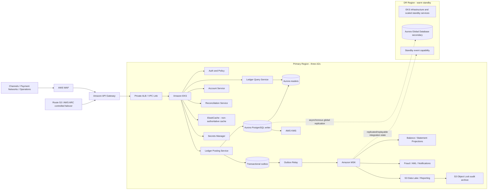

# AWS Core Ledger Architecture and Implementation Plan

## Executive recommendation

Build the core ledger as a **strongly consistent, append-only, double-entry posting engine** on **Amazon Aurora PostgreSQL**, with stateless services on **Amazon EKS**, a **transactional outbox**, and **Amazon MSK** for downstream events. Keep Aurora as the sole financial system of record; treat Kafka, search, reporting, and customer-facing balance views as derived projections that can be rebuilt from committed ledger data.

Do **not** use Amazon QLDB for a new implementation. Older AWS core-banking guidance used QLDB, but AWS ended QLDB support on July 31, 2025. Aurora PostgreSQL is the practical replacement: AWS documents its use for core banking, and Aurora stores data across six storage nodes in three Availability Zones.

The recommended baseline assumes:

- A regulated financial double-entry ledger rather than a general accounting application.
- Primary deployment in Asia Pacific (Sydney), with an Australian disaster-recovery region subject to service-by-service availability validation.
- EKS-based microservices, multi-AZ production, and cross-Region warm standby.
- Near-real-time posting, account balances, holds, reversals, reconciliation, and downstream event publication.
- No distributed transaction across services on the posting path.

## Design principles

1. **The database transaction is the accounting boundary.** A financial transaction, all debit and credit legs, affected balance rows, idempotency record, and outbox event commit atomically in Aurora.
2. **Double entry is enforced, not assumed.** Every posted transaction must balance by ledger, currency, and value date; unbalanced transactions must fail before commit.
3. **Posted history is never edited.** Corrections use linked reversal and replacement transactions. Application roles receive no `UPDATE` or `DELETE` rights over posted journals.
4. **One authoritative writer.** A single active Region owns posting. The DR Region must remain read-only until a controlled failover fences the old writer.
5. **Events are consequences of commits.** Never publish an event and update the ledger as separate, uncoordinated writes. AWS recommends transactional outbox or CDC for this dual-write problem and warns that consumers must handle duplicate messages.
6. **Exactly-once financial effect, at-least-once delivery.** Idempotency and database uniqueness guarantee one posting effect; messaging may redeliver, so every consumer deduplicates by immutable event ID.
7. **Reads do not endanger posting.** Statements, search, analytics, fraud features, and regulatory reports use replicas or independently built projections.
8. **Reconciliation is a first-class service.** Continuously prove that journal legs balance, balances equal journal-derived positions, events match committed postings, and external settlement totals match internal records.

## Target architecture



AWS recommends multi-AZ EKS deployments, private worker subnets, and topology spread constraints; managed node groups can distribute nodes across AZs. Aurora provides automated failover to replicas, fault-tolerant storage across three AZs, continuous incremental backups, and point-in-time recovery during the configured retention period.[7][8][9]

### Service selection

| Capability | Recommended service | Reason and constraint |
|---|---|---|
| External API | API Gateway + WAF | Authentication, throttling, schema controls, request limits, and perimeter protection; AWS core-banking guidance places API Gateway and WAF at the API boundary. |
| Transaction services | EKS across three AZs | Suitable for long-running, low-latency services and existing platform engineering practices; spread replicas and retain enough capacity after loss of one AZ. |
| Ledger system of record | Aurora PostgreSQL provisioned cluster | ACID relational transactions, constraints, SQL auditability, mature PostgreSQL tooling, Multi-AZ resilience, readers, backups, and Global Database DR. |
| Connection management | RDS Proxy | Protects the writer from pod-driven connection storms; use bounded application pools and explicit transaction timeouts. |
| Event backbone | Amazon MSK | Durable ordered streams, replay, independent consumer scaling, and per-key ordering when records for the same account or transaction use the same partition key. |
| Atomic event publication | Outbox table + relay | Ledger rows and outbox row commit together; relay publication is retryable and consumers remain idempotent.[5] |
| Workflow | Step Functions | Use for account opening, settlement, exception handling, and other multi-service sagas—not for the atomic ledger posting itself. AWS recommends idempotent saga participants. |
| Operational cache | ElastiCache | Cache reference data, limits, or derived views only. Never make Redis the source of truth for balances. |
| Audit archive | S3 with versioning, Object Lock, KMS | Store immutable exports, reconciliations, deployment evidence, database audit logs, and daily signed ledger digests. |
| Security telemetry | CloudTrail, Config, GuardDuty, Security Hub, CloudWatch | Centralized preventive and detective controls across accounts. AWS’s financial-services guidance recommends Organizations and Control Tower for governed multi-account environments. |
| Observability | ADOT/OpenTelemetry + CloudWatch Application Signals | Collect metrics, logs, traces, dependency telemetry, and SLOs from EKS workloads. |
| Card cryptography, if needed | AWS Payment Cryptography | Managed payment cryptography aligned to PCI PIN, P2PE, and PCI DSS, backed by PCI PTS HSM and FIPS-certified hardware. |

## Account and network layout

Use AWS Organizations and Control Tower with separate accounts for:

- Management and identity.
- Security tooling.
- Central log archive.
- Shared network services.
- Development ledger.
- Test and performance ledger.
- Production ledger.
- Production data and analytics.
- Disaster recovery.

Production and non-production must be isolated at the account, IAM, network, encryption-key, and data levels. AWS’s Financial Services Industry Lens recommends separate production and non-production accounts and SCPs to constrain actions.

Within each workload Region:

- Use a dedicated VPC with application, data, and ingress subnets across three AZs.
- Run EKS nodes and databases only in private subnets.
- Use VPC endpoints for ECR, S3, CloudWatch, STS, KMS, Secrets Manager, and other supported services to reduce public egress.
- Put API Gateway in front of an internal load balancer through private integration where practical.
- Restrict Aurora security-group ingress to the ledger services and controlled DBA break-glass path.
- Use Transit Gateway for approved shared services and Direct Connect or VPN for data-centre/payment-network connectivity.
- Create explicit egress controls using network firewalling, DNS controls, and allow-listed destinations.

## Ledger domain model

### Core entities

| Entity | Purpose | Key rules |
|---|---|---|
| `ledger` | Legal/entity-level accounting boundary | Defines base metadata, chart rules, status, and allowed currencies. |
| `account` | Customer or internal bookkeeping account | Immutable account ID; state changes are versioned; currency and account type are controlled. |
| `financial_transaction` | Business event submitted for posting | Globally unique transaction ID, idempotency key, type, effective time, value date, status, source, correlation ID, reversal link. |
| `journal_entry` | Posting header | Immutable sequence, ledger, currency, business reference, created time, posting rule version. |
| `journal_line` | Debit or credit leg | Account ID, direction, amount in minor units, currency, dimensions; amount must be positive. |
| `account_balance` | Current materialized balance | Updated in the same transaction as journal lines; version column supports optimistic checks. |
| `balance_bucket` | Available, posted, pending, held, credit-limit positions | Buckets are explicitly defined; do not overload one balance field. |
| `hold` | Reservation before final posting | Lifecycle is created, adjusted, captured, released, or expired; every transition is idempotent. |
| `idempotency_record` | Retry protection | Unique on tenant/source/idempotency key; stores request hash and final result. |
| `outbox_event` | Committed event awaiting publication | Immutable event ID, aggregate key, sequence, payload/schema version, commit timestamp, publish status. |
| `posting_rule` | Versioned accounting policy | Product event maps to debit/credit legs; approved versions cannot be changed in place. |
| `reconciliation_result` | Evidence of control execution | Control ID, scope, totals, variances, status, evidence location, execution time. |

### Monetary representation

Store monetary values as integer minor units where every supported currency has fixed precision, or use constrained `NUMERIC` when products require variable precision. Never use floating point. Record currency on every journal line and do not net different currencies in a single balancing rule; foreign-exchange postings require explicit currency-position and gain/loss legs.

### Database invariants

Enforce the following in PostgreSQL using primary keys, foreign keys, unique constraints, check constraints, restricted roles, and deferred constraint triggers where necessary:

- Sum of debits equals sum of credits for every ledger, currency, and journal entry.
- A posted entry has at least two lines.
- Amounts are positive and direction is from an allowed enum.
- A request’s idempotency key can create at most one financial transaction.
- A reversal references one original posting and cannot exceed the unreversed amount unless policy explicitly permits partial reversals.
- Posted journal rows cannot be updated or deleted by application or operator roles.
- Each account balance version advances monotonically.
- Account status and currency are validated before posting.
- Backdated postings use a controlled value date and retain the actual system posting timestamp.

Partition `journal_entry` and `journal_line` by a retention-friendly key such as posting month, then subpartition or index by ledger/account according to measured query patterns. Do not choose partition counts until load tests demonstrate transaction throughput, index growth, vacuum behavior, and end-of-day query needs.

## Posting transaction

The critical synchronous path should contain as few network calls as possible:

1. API Gateway authenticates the caller, applies throttling, and forwards a correlation ID.
2. The posting service validates schema, currency precision, source authorization, and request size.
3. It starts one Aurora transaction at `READ COMMITTED` plus explicit row locking, or `SERIALIZABLE` only if testing proves the contention cost acceptable.
4. It inserts the idempotency key using a unique constraint. If the key exists, it returns the stored result when the request hash matches; otherwise it rejects key reuse with a different payload.
5. It locks affected account/balance rows in deterministic account-ID order to reduce deadlocks.
6. It loads the approved posting-rule version and validates account state, limits, holds, effective dates, and overdraft policy.
7. It creates the transaction header, journal entry, and all debit/credit lines.
8. Database constraints verify balanced legs and valid references.
9. It updates authoritative balance buckets and records before/after balance versions.
10. It inserts one or more outbox records with deterministic event IDs and per-aggregate sequence numbers.
11. It commits once and returns the immutable transaction ID and status.
12. The outbox relay publishes to MSK after commit. A crash may cause republishing, so consumers deduplicate by event ID.

Use stable idempotency keys and uniqueness constraints rather than trying to guarantee exactly one network execution. AWS guidance describes idempotent writes through conditional inserts, transactional check-and-write, and deterministic event IDs in append-only logs.

### Example API contract

```http
POST /v1/ledger-transactions
Idempotency-Key: pay-20261013-000184
X-Correlation-Id: 9cce...
```

```json
{
  "ledgerId": "retail-au",
  "transactionType": "FUNDS_TRANSFER",
  "effectiveAt": "2026-10-13T09:20:00+11:00",
  "currency": "AUD",
  "amountMinor": 12500,
  "fromAccountId": "acct-10001",
  "toAccountId": "acct-20009",
  "reference": "invoice-8192"
}
```

The API should accept a business command, not arbitrary journal lines, for normal callers. Only tightly controlled internal posting interfaces should accept explicit journal legs.

## Events and read models

Publish versioned domain events such as:

- `LedgerTransactionPosted.v1`
- `LedgerTransactionReversed.v1`
- `AccountBalanceChanged.v1`
- `HoldCreated.v1`
- `HoldCaptured.v1`
- `HoldReleased.v1`
- `ReconciliationExceptionRaised.v1`

Partition events by the ordering boundary required by the consumer—usually account ID for account balance projections, and transaction ID for transaction workflows. Maintain `event_id`, `aggregate_id`, `aggregate_sequence`, `occurred_at`, `committed_at`, `schema_version`, `trace_id`, and source ledger metadata in every envelope.

Downstream consumers must maintain a processed-event table or equivalent conditional-write record. Kafka transactions can improve processing guarantees inside the Kafka pipeline, but they do not replace ledger-side idempotency for database or external side effects.

Recommended projections are:

- Customer balance and recent-transactions view.
- Statement view by account and value date.
- Operations search index.
- General-ledger aggregation and trial balance.
- Regulatory and finance data lake.
- Fraud and AML feature stream.
- Notifications.

A projection lag must never change the posting outcome. If a caller requires the committed result immediately, return it from the ledger transaction or a strongly consistent query against Aurora—not from Kafka or a cache.

## Security controls

### Identity and access

- Federate workforce access through IAM Identity Center; prohibit routine IAM users and long-lived access keys.
- Use EKS Pod Identity or IRSA so each service has a dedicated least-privilege role.
- Separate application, migration, read-only, reconciliation, and break-glass database roles.
- Require just-in-time privileged access, MFA, approval, session recording where applicable, and automatic expiry.
- Apply maker-checker approval for posting-rule activation, manual adjustments, DR failover, and security-policy changes.
- Prevent direct production data changes; emergency corrections must go through a controlled compensating-posting workflow.

### Encryption and keys

Encrypt Aurora, MSK, EBS, S3, backups, logs, and secrets with customer-managed KMS keys. AWS’s PCI guidance recommends KMS for native service integration and CloudHSM when dedicated single-tenant hardware, exportable key material, or a specific compliance mandate is required; CloudTrail records KMS and CloudHSM API activity.

Use TLS for all service and database connections, automatic certificate rotation, separate keys by environment and data classification, restrictive key policies, and tested key-recovery procedures. If card PIN or payment-network cryptography is in scope, use AWS Payment Cryptography rather than implementing those operations in application code.

### Auditability

Create multiple independent audit layers:

- Immutable journal and reversal history.
- PostgreSQL audit logs and database activity monitoring.
- CloudTrail organization trails to a dedicated log-archive account.
- EKS API audit logs and signed deployment provenance.
- Daily journal control totals and cryptographic digest files written to locked S3 storage.
- Config snapshots, IAM Access Analyzer findings, Security Hub findings, and change tickets.
- Reconciliation evidence retained according to legal and regulatory policy.

A relational append-only design does not automatically provide QLDB’s former built-in hash-chain verification. If cryptographic tamper evidence is required, implement and independently review a digest scheme—for example, deterministic canonical transaction serialization, per-batch Merkle roots, KMS signatures, and Object-Locked storage—rather than claiming database immutability alone provides cryptographic proof. QLDB’s former verification used sequenced hash-chained blocks, digests, and Merkle proofs, but that service is no longer supported.

## Availability and disaster recovery

### Single-Region resilience

- Deploy EKS node groups, ingress, and service replicas across three AZs.
- Use at least three replicas for critical stateless services with topology spread constraints and PodDisruptionBudgets.
- Maintain enough reserved or pre-scaled capacity to serve traffic after losing one AZ.
- Deploy an Aurora writer plus at least two appropriately sized readers in separate AZs.
- Configure RDS Proxy, conservative pool limits, statement and lock timeouts, and circuit breakers.
- Exercise EKS zonal shift and prove the platform runs with one AZ removed; AWS explicitly recommends this testing.

### Cross-Region DR

Use Aurora Global Database with asynchronous replication to a secondary Region. AWS states that Global Database RTO can be in the order of minutes and RPO is typically measured in seconds; Aurora PostgreSQL can enforce an RPO upper bound, but doing so may block or affect primary-writer transaction processing.

Recommended DR policy:

- **Target:** provisional RPO of 30 seconds and RTO of 15 minutes, to be approved through business-impact analysis and proven by tests.
- Keep the secondary Aurora cluster read-only, continuously monitor replication lag, and pre-provision critical network, IAM, secrets, EKS, container images, and configuration.
- Replicate immutable artifacts, schemas, IaC state backups, MSK topic definitions, and S3 evidence to the DR Region.
- Use a failover runbook that declares an incident, freezes new posting, verifies old-writer fencing, promotes the secondary, switches application configuration, validates control totals, resumes posting, and records the recovery point.
- Never run active-active posting against two independent relational primaries. This introduces split-brain and irreconcilable balance risks.
- After recovery, reconcile the last confirmed transaction sequence, all outbox events, external payment acknowledgements, and any accepted-but-uncommitted requests.

Both Aurora PostgreSQL and Aurora MySQL are listed in Sydney and Melbourne, but exact engine-version and Global Database feature compatibility must be confirmed during detailed design. AWS documentation states Australian customers may choose Sydney or Melbourne for onshore deployment, subject to their own regulatory decisions.

## Backup and recovery

- Configure continuous Aurora backups and the maximum business-approved retention, up to the service’s supported 35 days.
- Take immutable pre-release snapshots and cross-account/cross-Region copies based on policy.
- Export long-term ledger, reconciliation, and audit evidence to S3 with retention controls.
- Run automated restore tests into an isolated account; a backup is not proven until restoration and accounting reconciliation pass.
- Test point-in-time recovery after accidental data modification, schema error, and compromised credentials.
- Define separate procedures for database recovery, regional failover, event replay, read-model rebuild, and forensic preservation.

## Observability and controls

Collect technical and business telemetry with OpenTelemetry/ADOT. CloudWatch Application Signals can provide call volume, availability, latency, faults, errors, dependencies, and SLO monitoring for EKS applications.

### Proposed SLOs

These are initial design targets, not AWS guarantees:

| Indicator | Initial target | Measurement |
|---|---:|---|
| Posting API availability | 99.99% monthly | Valid requ
